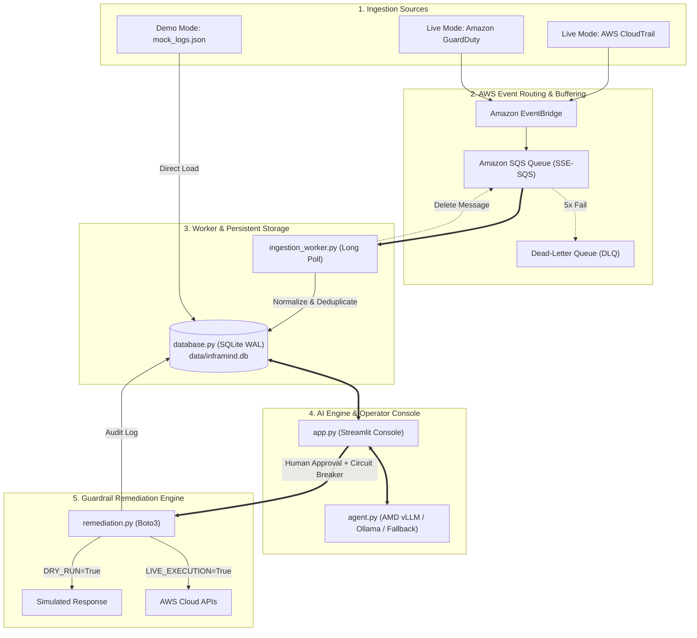

# InfraMind — AI Cloud Security Guardrail for Startups & IT
## Version 2: Near-Real-Time Cloud Security & Controlled Remediation Platform


InfraMind is an AI-assisted cloud security threat detection, prioritization, and controlled auto-patching engine built for modern startups, IT engineering departments, and DevOps teams.

It bridges the gap between raw AWS security telemetry (CloudTrail and GuardDuty) and safe cloud remediation. Operating in dual modes—**Demo Mode** (offline with curated mock logs) and **AWS Live-Ingestion Mode** (event-driven via EventBridge and SQS)—InfraMind analyzes threats using open-weights LLMs accelerated on AMD Instinct GPUs (with local Ollama and deterministic rule-based fallbacks), persists incidents in a thread-safe SQLite database, and executes controlled, single-click AWS Boto3 remediations with human-in-the-loop authorization.

---

## 1. Project Introduction
Cloud infrastructure moves fast, but security breaches happen in seconds. Startups and high-growth engineering teams lack dedicated 24/7 Security Operations Centers (SOC). When developers inadvertently create public Amazon S3 buckets or leak AWS IAM access keys in public code repositories, automated attacker bots exploit them within minutes.

InfraMind closes the gap between raw telemetry and safe cloud remediation through a human-in-the-loop, AI-assisted guardrail.

---

## 2. Problem Statement
1. **Acute Alert Fatigue:** AWS CloudTrail produces tens of thousands of raw JSON lines per day. Critical misconfigurations drown in operational noise.
2. **Specialized IAM/S3 Complexity:** Interpreting bucket ACLs, wildcard bucket policies, and cross-account IAM permissions requires senior cloud security expertise.
3. **The Manual Remediation Bottleneck:** Navigating the AWS Management Console during high-stress security incidents is slow, error-prone, and risks breaking live production dependencies.

---

## 3. Proposed Solution
InfraMind implements an automated, closed-loop telemetry pipeline:
- **Dual Operating Modes:** Run offline with zero cloud credentials in **Demo Mode**, or stream genuine telemetry from an authorized AWS account in **AWS Live-Ingestion Mode**.
- **Resilient Event Buffering:** Captures CloudTrail and GuardDuty events via Amazon EventBridge, buffered by an Amazon SQS Queue with an automated Dead-Letter Queue (DLQ).
- **Background Ingestion Worker:** Long-polling worker (`ingestion_worker.py`) normalizes divergent schemas, verifies S3 live posture in read-only mode, and atomically commits events to SQLite.
- **ACID Incident Persistence:** SQLite store with Write-Ahead Logging (WAL) ensures concurrent read/write access, analysis caching, and idempotent deduplication.
- **AI-Powered Threat Prioritization:** Evaluates incident severity (`CRITICAL`, `HIGH`, `MEDIUM`, `LOW`), calculates blast radius (0–10), and assigns whitelisted remediation actions using AMD ROCm vLLM or Ollama.
- **Controlled Auto-Patching:** Standardized, test-verified Boto3 remediation scripts that execute safely with default dry-run simulation and explicit human authorization.
- **Incident Time-Machine:** Conversational assistant for historical log queries and compliance audits.

---

## 4. Main Features
- 🔄 **Dual Operating Modes:** Toggle between offline `demo` mode and real-time AWS `live` ingestion.
- 📡 **Near-Real-Time Event Ingestion:** Dedicated background worker long-polling Amazon SQS (`WaitTimeSeconds=20`) with DLQ poison-pill isolation.
- 🗄️ **Persistent SQLite Incident Store:** Thread-safe WAL mode storage preventing data loss across dashboard reboots.
- 🚨 **Live Operator Console:** Streamlit dashboard with real-time SQS queue depth monitoring, worker heartbeat indicators, and configurable auto-refresh (10s).
- 🔍 **Multi-Dimensional Query Filters:** Instant filtering by Severity (`CRITICAL`, `HIGH`, `MEDIUM`, `LOW`), Event Source (`S3`, `IAM`, `GuardDuty`), and Status (`OPEN`, `RESOLVED`).
- 📋 **Raw Telemetry Inspector:** In-depth JSON metadata inspector for deep security forensic analysis.
- 🤖 **Multi-Provider AI Threat Engine:** Supports AMD Instinct GPUs (ROCm vLLM), local Ollama (`llama3:8b`), and rapid deterministic rule-based fallback.
- 🛡️ **Safe Dry-Run Simulations by Default:** Zero accidental cloud mutations. `DRY_RUN=True` and `LIVE_EXECUTION_ENABLED=False` protect production.
- ⚡ **1-Click Controlled Patching:**
  - **S3 Public Bucket Remediation:** Applies AWS S3 Public Access Block (enabling all 4 restriction flags).
  - **IAM Access Key Revocation:** Safely sets access keys to `Inactive` without deleting them, preserving CloudTrail forensic trails.
- 🔒 **Defense-in-Depth Guardrails:** Mandatory operator approval checkboxes, exact identity validation, and automated lockout of root account keys.
- 💬 **Incident Time-Machine:** Natural-language conversational assistant answering audit inquiries.
- 🧪 **Comprehensive Quality Assurance:** 63 automated offline unit tests with 100% pass rate.

---

## 5. System Architecture



---

## 6. Technology Stack
- **Backend & Logic:** Python 3.10+ (tested on Python 3.12)
- **Persistence:** SQLite 3 (WAL Mode, Thread-Safe)
- **Cloud Infrastructure:** AWS CloudFormation, Amazon EventBridge, Amazon SQS, CloudTrail, GuardDuty
- **Cloud SDK:** AWS Boto3 & Botocore
- **Web UI & Dashboard:** Streamlit
- **LLM Serving & Inference:** AMD Developer Cloud (ROCm vLLM) / Ollama / OpenAI Standard API
- **Testing:** Python `unittest` & `unittest.mock` (zero external test dependencies)
- **Configuration:** `python-dotenv`
- **Presentation Deck:** `python-pptx`

---

## 7. Project Folder Structure

```text
InfraMind-Team/
|
|-- app.py                     # Streamlit web dashboard & Incident Time-Machine
|-- agent.py                   # AI log evaluation engine & conversational query solver
|-- database.py                # Thread-safe SQLite persistence layer (WAL mode & audit log)
|-- ingestion_worker.py        # Background SQS long-polling worker & event normalizer
|-- remediation.py             # Member 3: S3 & IAM cloud remediation scripts & safety gates
|-- mock_logs.json             # Realistic CloudTrail security incident events (S3 & IAM)
|-- requirements.txt           # Unified project runtime dependencies
|-- .env.example               # Safe environment configuration template
|-- .gitignore                 # Excludes .env, virtual environments, databases, and caches
|-- deploy_amd.sh              # AMD ROCm vLLM docker container deployment script
|-- README.md                  # Master project architecture and operational guide
|-- README_MEMBER3.md          # Dedicated technical guide for Member 3 module
|-- sample_incidents.json      # Sample data contract for Member 2 & Member 5
|-- build_pitch_deck.py        # Script generating 12-slide PowerPoint presentation
|
|-- infra/
|   `-- cloudformation-realtime.yaml # CloudFormation template for SQS, DLQ, and EventBridge
|
|-- docs/
|   |-- architecture.md        # Technical architecture, sequence diagrams, and risk notes
|   |-- realtime_architecture.md # Real-time pipeline specs, failure modes, and retry rules
|   |-- aws_setup.md           # Step-by-step AWS CLI setup, stack deployment, and IAM policies
|   `-- security_controls.md   # Defense-in-depth, dry-run, and key deactivation rules
|
|-- presentation/
|   |-- InfraMind_Pitch_Deck.pptx # Editable 12-slide widescreen PowerPoint pitch deck
|   |-- slides_content.md      # Markdown transcript of all 12 pitch deck slides
|   `-- demo_script.md         # Timed 5-minute presenter script & video storyboard
|
`-- tests/
    |-- __init__.py            # Test package marker
    |-- test_remediation.py    # 34 Member 3 remediation & safety tests
    |-- test_agent.py          # 16 AI analysis, LLM client, and chat history tests
    |-- test_database.py       # 6 SQLite persistence, schema, and audit tests
    `-- test_ingestion.py      # 7 SQS worker, normalization, and DLQ lifecycle tests
```

---

## 8. Prerequisites (Windows / Linux)
- **Operating System:** Windows 10/11 (64-bit) or Linux (Ubuntu 22.04+).
- **Python:** Python 3.10, 3.11, or 3.12 (verified with Python 3.12.10).
- **Terminal:** Windows PowerShell, Windows Terminal, or Bash.
- **Git:** Installed and configured.

Verify Python installation:
```powershell
python --version
```

---

## 9. Setup & Installation

```powershell
# 1. Clone or navigate to the repository
cd C:\Users\santh\InfraMind-Team

# 2. Create the Python virtual environment
python -m venv .venv

# 3. Allow execution for the current PowerShell session (if restricted)
Set-ExecutionPolicy -Scope Process -ExecutionPolicy Bypass

# 4. Activate the virtual environment
.\.venv\Scripts\Activate.ps1

# 5. Install runtime dependencies
python -m pip install --upgrade pip
python -m pip install -r requirements.txt
```

---

## 10. Environment Configuration

Copy the template `.env.example` into a local `.env`:
```powershell
Copy-Item .env.example .env
```

Contents of `.env`:
```ini
# Operating Mode: demo (offline mock_logs.json) or live (Amazon SQS ingestion)
APP_MODE=demo

# AWS Region & Credentials (used in live mode)
AWS_REGION=us-east-1
AWS_DEFAULT_REGION=us-east-1
# Leave empty to use local AWS CLI profile (~/.aws/credentials)
AWS_ACCESS_KEY_ID=
AWS_SECRET_ACCESS_KEY=

# Ingestion SQS Queue URL (from CloudFormation stack output)
SQS_QUEUE_URL=

# Database & Ingestion Worker
DATABASE_PATH=data/inframind.db
WORKER_POLL_INTERVAL=20
DASHBOARD_REFRESH_SECONDS=10

# AI Threat Engine Provider: amd, ollama, or deterministic_fallback
AI_PROVIDER=amd
AMD_ENDPOINT_URL=http://localhost:11434/v1
MODEL_NAME=meta-llama/Meta-Llama-3-8B-Instruct

# Member 3 Guardrail Safety Controls
DRY_RUN=True
LIVE_EXECUTION_ENABLED=False
```

> **Safety Notice:** `.env` is excluded from Git via `.gitignore`. Never hardcode AWS secrets or tokens.

---

## 11. Running InfraMind

### Mode A: Demo Mode (Offline, Zero Credentials)
In Demo Mode, InfraMind loads sample security events from `mock_logs.json`. Run with a single terminal command:

```powershell
streamlit run app.py
```
Open your browser at `http://localhost:8501`.

### Mode B: AWS Live-Ingestion Mode (Real Telemetry)
In Live Mode, run the background worker and the operator dashboard in two separate PowerShell terminal windows:

#### Terminal 1: Background Ingestion Worker
```powershell
# In C:\Users\santh\InfraMind-Team
.\.venv\Scripts\Activate.ps1
python ingestion_worker.py
```
The worker connects to SQS, performs 20-second long-polling, normalizes incoming CloudTrail/GuardDuty events, checks live S3 posture, and persists incidents into `data/inframind.db`.

#### Terminal 2: Streamlit Operator Console
```powershell
.\.venv\Scripts\Activate.ps1
streamlit run app.py
```
The dashboard auto-refreshes every 10 seconds, displays SQS queue metrics, and surfaces incoming threats immediately.

---

## 12. Deploying AWS Infrastructure via CloudFormation
To enable live telemetry ingestion, deploy the provided CloudFormation template:

```powershell
aws cloudformation deploy `
  --template-file infra/cloudformation-realtime.yaml `
  --stack-name inframind-realtime-telemetry `
  --capabilities CAPABILITY_IAM `
  --region us-east-1
```
For complete step-by-step instructions, see [`docs/aws_setup.md`](file:///C:/Users/santh/InfraMind-Team/docs/aws_setup.md).

---

## 13. Running Automated Unit Tests

Execute the complete 63-test automated test suite:
```powershell
python -m unittest discover -s tests -v
```

Expected output:
```text
test_s3_successful_api_call_returns_success ... ok
test_iam_successful_api_call_returns_success ... ok
test_database_crud_and_deduplication ... ok
test_ingestion_sqs_message_lifecycle ... ok
...
Ran 63 tests in 1.266s

OK
```
- **100% Offline:** All 63 tests run without internet connection, AWS accounts, or mock servers.
- **Coverage:** Input validation, Boto3 S3/IAM mocks, LLM parsing, rule-based fallback, SQLite CRUD/WAL, SQS worker lifecycle, and poison-pill recovery.

---

## 14. Safety Controls & Guardrails Summary

1. **Simulation Default:** `DRY_RUN=True` simulates all actions and returns `SIMULATED`.
2. **Circuit Breaker:** `LIVE_EXECUTION_ENABLED=False` prevents live cloud calls unless explicitly enabled.
3. **Mandatory Human Approval:** In the UI, the operator must review the exact target resource and check the authorization box before clicking **"⚡ Approve & Execute Patch"**.
4. **Non-Destructive IAM Revocation:** IAM keys are set to `Inactive` rather than deleted, preserving forensic evidence for CloudTrail audits.
5. **Root Protection:** Automated deactivation of root account credentials is hardcoded as `BLOCKED`.
6. **SQS Invariant:** Messages are deleted from SQS *strictly after* successful database persistence.
7. **Secret Redaction:** Access keys, tokens, and authorization headers are automatically redacted from logs and audit trails.

For detailed security specifications, see [`docs/security_controls.md`](file:///C:/Users/santh/InfraMind-Team/docs/security_controls.md).

---

## 15. Troubleshooting

| Issue | Cause | Resolution |
| :--- | :--- | :--- |
| `running scripts is disabled` | PowerShell execution policy restricted | Run `Set-ExecutionPolicy -Scope Process Bypass`. |
| `ModuleNotFoundError: No module named 'streamlit'` | Virtual environment not activated | Run `.\.venv\Scripts\Activate.ps1` and verify `pip list`. |
| `LIVE INGESTION: NOT CONFIGURED` | `SQS_QUEUE_URL` is empty in `.env` | Set `SQS_QUEUE_URL` to your CloudFormation queue URL or switch `APP_MODE=demo`. |
| Remediation returns `SIMULATED` | Safe local mode is active (`DRY_RUN=True`) | Expected behavior. For real cloud changes, configure valid AWS credentials, set `DRY_RUN=False`, `LIVE_EXECUTION_ENABLED=True`, and pass `approved=True`. |
| AI Engine reports `Offline Fallback` | AMD/Ollama model server not running | Application remains fully functional via deterministic rule-based analysis. Start Ollama (`ollama run llama3:8b`) or AMD vLLM container if LLM output is desired. |
| Remediation returns `BLOCKED` | Approval checkbox unchecked or root user targeted | Check the operator authorization box. If targeting root account, use AWS Management Console manually. |

---

## 16. Team Responsibilities & Module Integration
- **Member 3 (Auto-Patch Engine):**
  - File: [`remediation.py`](file:///C:/Users/santh/InfraMind-Team/remediation.py)
  - Documentation: [`README_MEMBER3.md`](file:///C:/Users/santh/InfraMind-Team/README_MEMBER3.md)
  - Functions: `fix_s3_bucket(bucket_name, *, approved=False)` and `revoke_iam_key(access_key_id, user_name=None, *, approved=False)`
- **Member 5 (Console & UI):**
  - File: [`app.py`](file:///C:/Users/santh/InfraMind-Team/app.py)
  - Status Handling: Handles `SIMULATED` (info alert), `SUCCESS` (green success alert), `BLOCKED` (warning alert), and `FAILED` (error alert).
