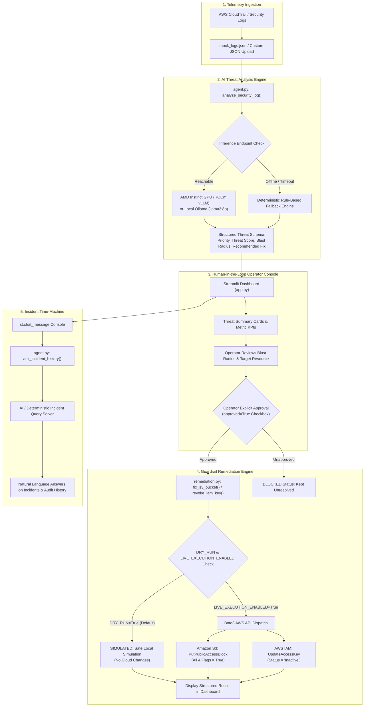

# InfraMind — System Architecture & Technical Specifications

## 1. Executive Summary

**InfraMind** is an AI-assisted cloud security guardrail application designed for modern startups, IT departments, and DevOps engineers. In fast-paced cloud environments, inadvertent misconfigurations—such as publicly accessible Amazon S3 storage buckets or exposed AWS IAM access keys—lead to catastrophic data breaches and unauthorized cloud infrastructure takeovers.

InfraMind provides an automated, closed-loop telemetry analysis and controlled auto-patching engine that:
1. Ingests raw AWS CloudTrail security events.
2. Evaluates threat severity (0–10) and blast-radius risk impact using large language models hosted on an AMD GPU endpoint (or local Ollama / offline deterministic fallback).
3. Delivers an interactive, human-in-the-loop remediation console in Streamlit.
4. Executes controlled, safe AWS SDK (Boto3) remediations with default dry-run simulation and strict human authorization gates.
5. Provides an "Incident Time-Machine" conversational AI assistant for interactive log auditing and incident timeline queries.

---

## 2. End-to-End Data Flow

---

## 3. Component Breakdown & Responsibilities

### Component A: Streamlit Dashboard (`app.py`)
- **Role:** Web presentation layer and operator interface.
- **Key Features:**
  - Executive KPI metrics (Total Alerts, Critical/High Threats, Awaiting Review, Remediated).
  - Active Threat Alert cards displaying event metadata, AI threat score, and blast radius.
  - Interactive "Analyze Alert via AMD GPU" dispatch button.
  - Human-in-the-loop explicit approval checkbox strictly bound to target resource identifier.
  - Controlled patch execution button rendering color-coded status badges (`SIMULATED`, `SUCCESS`, `BLOCKED`, `FAILED`).
  - Conversational Incident Time-Machine assistant with quick audit query suggestions.
  - JSON audit trail export.

### Component B: AI Threat Analysis Engine (`agent.py`)
- **Role:** Evaluates raw security telemetry into actionable risk intelligence.
- **Key Functions:**
  - `analyze_security_log(log_event)`: Normalizes threat severity (`CRITICAL`, `HIGH`, `MEDIUM`, `LOW`), scores (0–10), blast radius estimates (0–10), and assigns whitelisted remediation actions (`fix_s3_bucket`, `revoke_iam_key`, `none`).
  - `ask_incident_history(question, logs, analyses)`: Conversational assistant answering natural language questions about active incidents, flagged API keys, and remediation status.
- **Model Endpoints:**
  - Configurable via `AMD_ENDPOINT_URL` and `MODEL_NAME`.
  - Supports AMD Instinct GPUs running ROCm vLLM or local Ollama.
  - Implements rapid, non-blocking failover to a deterministic rule-based engine when LLM endpoints are unreachable.

### Component C: Auto-Patch & Remediation Engine (`remediation.py`)
- **Role:** Secure, auditable AWS automation scripts (Member 3 module).
- **Core Functions:**
  - `fix_s3_bucket(bucket_name, *, approved=False, s3_client=None)`: Configures all 4 AWS S3 Public Access Block settings to `True` (`BlockPublicAcls`, `IgnorePublicAcls`, `BlockPublicPolicy`, `RestrictPublicBuckets`).
  - `revoke_iam_key(access_key_id, user_name=None, *, approved=False, iam_client=None)`: Deactivates compromised keys via IAM `update_access_key(Status='Inactive')`. Preserves keys without deletion for auditability.
- **Safety Invariants:**
  - Default: `DRY_RUN=True`, `LIVE_EXECUTION_ENABLED=False`.
  - Requires `approved=True` passed by human operator.
  - Mandatory IAM target username validation; blocks automated deactivation of root account credentials.
  - Sensitive credential sanitization in all return payloads and logs (`sanitize_message`).

---

## 4. Local Implementation vs. External Services

| System Component | Implementation Status | External Dependency |
|---|---|---|
| **Streamlit Interface** | Fully implemented locally (`app.py`) | Python runtime, local browser |
| **Deterministic Threat Analysis** | Fully implemented locally (`agent.py`) | None (zero external dependencies) |
| **Conversational Assistant** | Fully implemented locally (`agent.py`) | None (deterministic fallback included) |
| **S3 & IAM Remediation Scripts** | Fully implemented locally (`remediation.py`) | None for dry-run simulation mode |
| **AMD GPU Inference Endpoint** | OpenAI-compatible client implemented | Requires remote AMD Instinct instance running ROCm / vLLM (falls back to local Ollama or rule-based engine if offline) |
| **Live AWS Cloud Changes** | Fully implemented via Boto3 APIs | Requires AWS credentials and setting `DRY_RUN=False`, `LIVE_EXECUTION_ENABLED=True` |

---

## 5. Security & Risk Considerations

1. **Blast Radius Estimation:**
   - The blast radius score (0–10) provided by the AI is an estimated risk proxy based on resource type, permission scope, and sensitivity indicators in telemetry. It does not represent an automated graph traversal of live production dependencies unless live cloud asset inventory data is integrated.
2. **Access Key Revocation Impact:**
   - Setting an IAM access key to `Inactive` immediately revokes all authentication privileges for any workload or automated script utilizing those credentials.
3. **S3 Public Access Block Impact:**
   - Enforcing all four bucket-level public access block flags will override bucket policies and object ACLs. If a bucket legitimately serves public documentation or assets, public access will be blocked until reconfigured.
