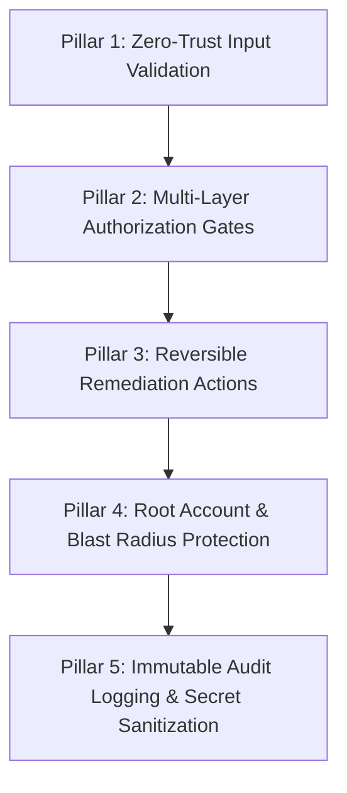
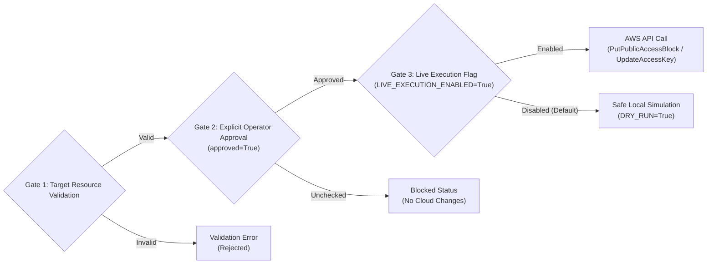

# InfraMind — Security Controls, Guardrails & Safety Architecture

## 1. Security Philosophy: Defense-in-Depth

Automated cloud remediation introduces significant operational risk if unconstrained. An errant remediation script could disrupt revenue-generating workloads, lock administrators out of cloud accounts, or destroy forensic evidence following an active intrusion.

InfraMind implements a strict **Defense-in-Depth Guardrail Framework** designed around five immutable safety pillars:



---

## 2. Multi-Layer Authorization Gates

Before any AWS API modification can execute, three independent boolean gates must simultaneously evaluate to `True`:



### Safety Gate Breakdown:
1. **Target Validation:** Bucket names and Access Key IDs are strictly validated against RFC/AWS specifications. Malformed, blank, or suspicious strings are immediately rejected.
2. **Explicit Operator Approval (`approved=True`):** The Streamlit UI requires the human operator to manually toggle a dedicated checkbox tied to the specific incident ID before the remediation button becomes active.
3. **Global Execution Gate (`LIVE_EXECUTION_ENABLED=True`):** Even with human approval, the system refuses to invoke real AWS Boto3 APIs unless the server process has `LIVE_EXECUTION_ENABLED=True` explicitly set in the environment.

---

## 3. Storage Safeguards: Amazon S3

### All Four Public Access Block Settings Enforced
When `fix_s3_bucket()` executes, it configures all four AWS Public Access Block settings to `True` simultaneously:
```python
s3_client.put_public_access_block(
    Bucket=bucket_name,
    PublicAccessBlockConfiguration={
        "BlockPublicAcls": True,
        "IgnorePublicAcls": True,
        "BlockPublicPolicy": True,
        "RestrictPublicBuckets": True,
    },
)
```
- **`BlockPublicAcls`**: Rejects any new public ACLs on the bucket or its objects.
- **`IgnorePublicAcls`**: Causes AWS to ignore all existing public ACLs on the bucket and its objects.
- **`BlockPublicPolicy`**: Rejects any new bucket policies that grant public access.
- **`RestrictPublicBuckets`**: Restricts access to the bucket to AWS service principals and authorized users, regardless of existing policies.

### Read-Only Posture Verification
During ingestion, `ingestion_worker.py` queries `s3:GetBucketPublicAccessBlock` in read-only mode to determine whether the bucket is already protected, preventing unnecessary remediation runs.

---

## 4. Identity Safeguards: AWS IAM

### Deactivation vs. Permanent Deletion
InfraMind strictly **deactivates** compromised IAM access keys (`update_access_key(Status='Inactive')`) rather than permanently deleting them (`delete_access_key`).

| Security Dimension | Deactivation (`Status='Inactive'`) | Permanent Deletion (`delete_access_key`) |
| :--- | :--- | :--- |
| **Immediate Containment** | Instantly revokes all API/CLI permissions. | Instantly revokes all API/CLI permissions. |
| **Forensic Preservation** | Preserves key ID for CloudTrail correlation and investigation. | Destroys metadata; complicates post-incident forensic audits. |
| **Disaster Recovery** | Allows immediate re-enablement if revoked in error. | Irreversible. Requires generating and distributing new keys. |
| **Operational Impact** | Safe for production automation. | High risk of permanent pipeline breakage. |

### Root Account Lockout Protection
AWS root account credentials have unrestricted privileges across an entire AWS account. Automated tools must never manipulate root credentials.
InfraMind enforces hardcoded root account protection:
```python
if user_name and user_name.lower().strip() in ("root", "account_root", "<root_account>"):
    logger.warning("BLOCKED: revoke_iam_key targeted root account. Refusing automated deactivation.")
    return {"status": "BLOCKED", "message": "Automated deactivation refused for root account credentials."}
```

---

## 5. Telemetry & Queue Safeguards

### Atomic Ingestion & SQS Deletion Invariant
In `ingestion_worker.py`:
- Messages are removed from Amazon SQS **strictly after** the incident is committed to SQLite.
- If the database is locked, out of disk space, or encounters a write error, the SQS message is **not deleted**.
- SQS visibility timeout will expire, allowing another worker instance to retry the message or route it to the Dead-Letter Queue after 5 consecutive failures.

### Poison-Pill Discard Mechanism
If an incoming SQS message contains unparseable binary data or completely invalid JSON that cannot be normalized, the worker logs a warning with sanitized metadata and safely deletes the message to prevent it from cycling indefinitely and blocking valid security telemetry.

---

## 6. Data Privacy & Secret Sanitization

All log outputs, UI error banners, and database audit records are filtered through `sanitize_message()`:
- **AWS Access Key IDs** (`AKIA...`, `ASIA...`) are masked as `AKIA...[REDACTED]`.
- **AWS Secret Access Keys** (40-character base64 strings) are stripped entirely.
- **Bearer Tokens and Passwords** are redacted before storage or display.

---

## 7. Immutable Audit Trail

Every remediation invocation is recorded in the `remediation_audit` table in `data/inframind.db`:
- `audit_id`: Unique primary key.
- `timestamp`: UTC timestamp (ISO 8601).
- `event_id`: Reference to originating CloudTrail/GuardDuty event.
- `action`: Remediation function (`fix_s3_bucket` or `revoke_iam_key`).
- `resource_id`: Target AWS resource name/ID.
- `status`: Execution outcome (`SUCCESS`, `SIMULATED`, `BLOCKED`, `FAILED`).
- `execution_mode`: `LIVE` vs. `SIMULATION`.
- `approved_by_operator`: Boolean indicating human approval.
- `response_payload`: Sanitized JSON payload returned by AWS SDK.
